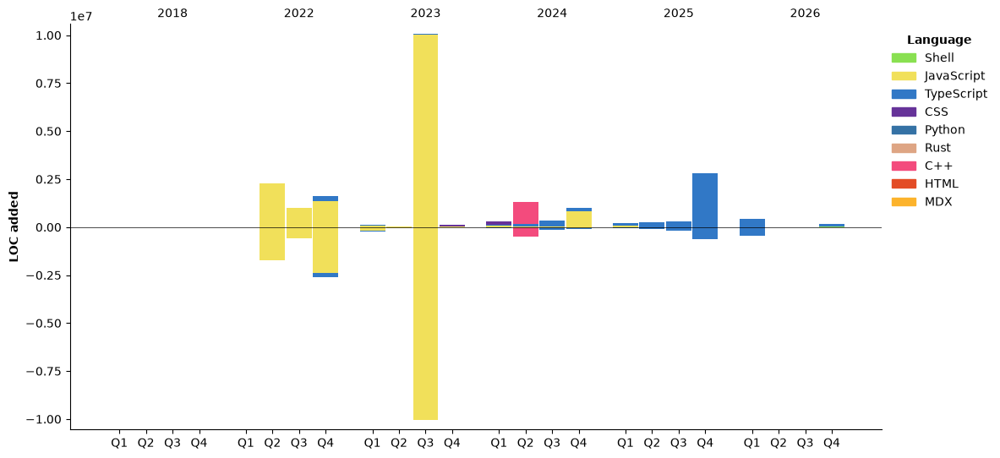

<div align="center">
  

  [](https://facebook.com/frierendv) [](https://instagram.com/david.stefen) [](https://linkedin.com/in/frierendv) [](mailto:itsrose.dev@gmail.com) 
  [](https://visitcount.itsvg.in)
</div>

<p align="center">
  <picture>
    <source
      media="(prefers-color-scheme: dark)"
      srcset="https://github-stats-extended.itsrose.my.id/api/top-langs?username=xct007&layout=compact&langs_count=6&show_icons=true&theme=onedark"
    />
    
  </picutre>

    
  <picture>
    <source
      media="(prefers-color-scheme: dark)"
      srcset="https://github-stats-extended.itsrose.my.id/api?username=xct007&show_icons=true&hide_title=true&include_all_commits=true&theme=onedark"
    />
    
  </picutre>

  <br />
  <br />
  
  <picture>
    <source
      media="(prefers-color-scheme: dark)"
      srcset="https://github-trophies.vercel.app/?username=xct007&no-frame=false&no-bg=false&margin-w=4&margin-h=2&theme=onedark"
    />
    
  </picture>
    
  <picture>
      <source
        media="(prefers-color-scheme: dark)"
        srcset="https://raw.githubusercontent.com/platane/snk/output/github-contribution-grid-snake-dark.svg"
    />
    
  </picture>
</p>


___
<!--START_SECTION:waka-->


**🐱 My GitHub Data** 

> 📦 1.8 MB Used in GitHub's Storage 
 > 
> 🏆 1,408 Contributions in the Year 2026
 > 
> 💼 Opted to Hire
 > 
> 📜 27 Public Repositories 
 > 
> 🔑 30 Private Repositories 
 > 
**I'm a Night 🦉** 

```text
🌞 Morning                3299 commits        ████░░░░░░░░░░░░░░░░░░░░░   17.90 % 
🌆 Daytime                5540 commits        ████████░░░░░░░░░░░░░░░░░   30.06 % 
🌃 Evening                5640 commits        ████████░░░░░░░░░░░░░░░░░   30.61 % 
🌙 Night                  3949 commits        █████░░░░░░░░░░░░░░░░░░░░   21.43 % 
```
📅 **I'm Most Productive on Sunday** 

```text
Monday                   3231 commits        ████░░░░░░░░░░░░░░░░░░░░░   17.53 % 
Tuesday                  2247 commits        ███░░░░░░░░░░░░░░░░░░░░░░   12.19 % 
Wednesday                1927 commits        ███░░░░░░░░░░░░░░░░░░░░░░   10.46 % 
Thursday                 2496 commits        ███░░░░░░░░░░░░░░░░░░░░░░   13.54 % 
Friday                   2252 commits        ███░░░░░░░░░░░░░░░░░░░░░░   12.22 % 
Saturday                 2700 commits        ████░░░░░░░░░░░░░░░░░░░░░   14.65 % 
Sunday                   3575 commits        █████░░░░░░░░░░░░░░░░░░░░   19.40 % 
```


📊 **This Week I Spent My Time On** 

```text
🕑︎ Time Zone: Asia/Bangkok

💬 Programming Languages: 
TypeScript               5 hrs 25 mins       ██████████░░░░░░░░░░░░░░░   40.02 % 
Python                   1 hr 35 mins        ███░░░░░░░░░░░░░░░░░░░░░░   11.73 % 
Other                    1 hr 19 mins        ██░░░░░░░░░░░░░░░░░░░░░░░   09.77 % 
Docker                   1 hr 10 mins        ██░░░░░░░░░░░░░░░░░░░░░░░   08.63 % 
JSON                     1 hr 4 mins         ██░░░░░░░░░░░░░░░░░░░░░░░   07.92 % 

💻 Operating System: 
Linux                    13 hrs 34 mins      █████████████████████████   100.00 % 
```

**I Mostly Code in TypeScript** 

```text
TypeScript               27 repos            ██████████░░░░░░░░░░░░░░░   41.54 % 
JavaScript               23 repos            █████████░░░░░░░░░░░░░░░░   35.38 % 
Python                   3 repos             █░░░░░░░░░░░░░░░░░░░░░░░░   04.62 % 
C++                      2 repos             █░░░░░░░░░░░░░░░░░░░░░░░░   03.08 % 
MDX                      1 repo              ░░░░░░░░░░░░░░░░░░░░░░░░░   01.54 % 
```


**Timeline**




 Last Updated on 24/11/2026 08:35:28 UTC
<!--END_SECTION:waka-->
